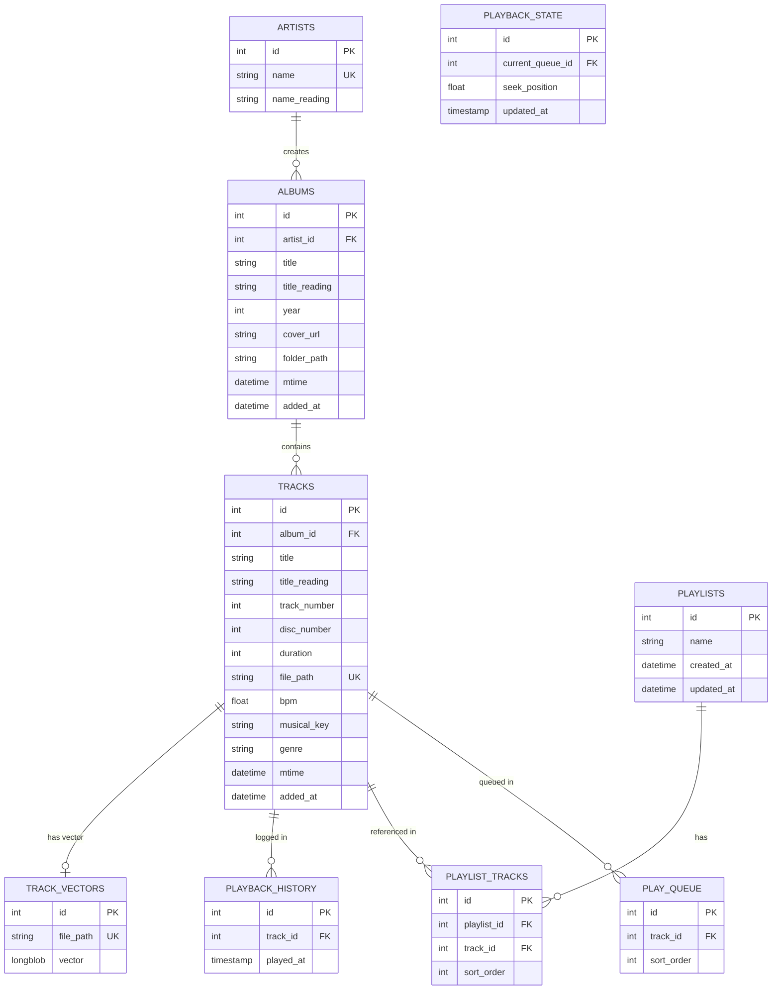
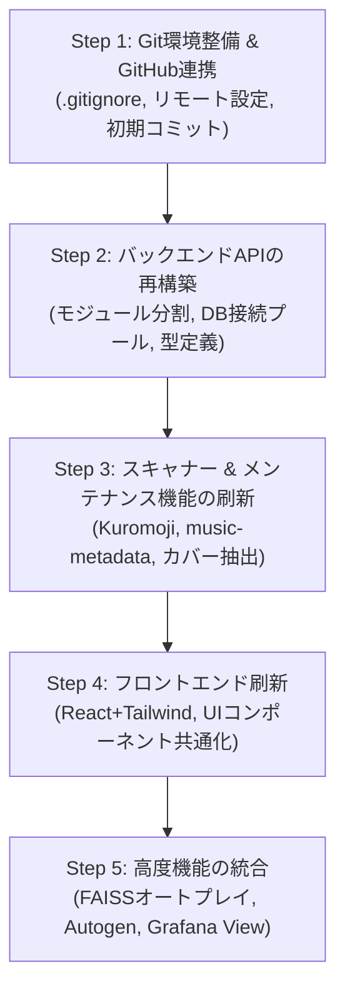

# FLAC Music Manager: 要件ダンプ ＆ ゼロベース再開発仕様書

これまで増築を重ねてきた現行システムの**全機能要件・データモデル・振る舞い・課題**を完全網羅してダンプ（洗い出し・整理）し、ゼロベースで美しい一貫性を持ったモダンなシステムへ再開発するための設計仕様書です。

---

## 1. 現行システムの全機能要件ダンプ

### 1.1 コア・バックエンド機能

#### A. 音楽ライブラリ・メタデータスキャン (`metadata_scanner.js`)
* **走査対象**: 環境変数 `MUSIC_DIR` 配下のディレクトリを再帰的に走査（`.flac` ファイル）。
* **除外設定**: `EXCLUDE_DIRS` で指定された前方一致パス、`@eaDir`（Synology等のサムネイル用ディレクトリ）、`flac-manager` 自身を除外。
* **差分スキャン (Delta Scan)**:
  * 既存トラックのファイルパスとディスク上の `mtime`（更新日時）を比較。
  * 秒単位で一致していればメタデータパースをスキップし、スキャン時間を短縮。
  * `--full` 引数で全件再スキャン可能。
* **タグ抽出 (`music-metadata`)**:
  * アーティスト (`common.artist`)
  * アルバムアーティスト (`common.albumartist`、未設定時は artist)
  * アルバム名 (`common.album`)
  * トラック名 (`common.title`、未設定時はファイル名ベース)
  * トラック番号 (`common.track.no`)
  * リリース年 (`common.year`)
  * 演奏時間 (`format.duration` 秒)
  * 独自ルール: 特定のコンピレーション（例: `autotune the world`, `Studio Simpa`）はアルバムアーティストを `Various Artists` に自動正規化。
* **日本語形態素解析・読み仮名自動付与 (`kuromoji`)**:
  * トークナイザー（辞書: `node_modules/kuromoji/dict`）を用いて、アーティスト名、アルバム名、曲名から読み仮名（カタカナ）を自動生成。
  * `artists.name_reading`, `albums.title_reading`, `tracks.title_reading` に保存。
* **カバーアート自動抽出**:
  * FLACファイルの埋め込み画像（ID3/VORBISピクチャ）を優先取得。
  * 埋め込みが無い場合、同ディレクトリ内の `cover.jpg`, `cover.png`, `folder.jpg`, `folder.png`, `front.jpg`, `front.png` を探索。
  * 抽出画像は `public/covers/album_<album_id>.<ext>` に永続保存し、DBにURL（`/covers/...`）を保存。
* **メンテナンス・運用スクリプト**:
  * `dedupe_artists.js`: 同名アーティストの統合と外部キー付け替え、ユニークインデックス修復。
  * `cleanup_excluded.js`: 除外ディレクトリに該当する孤立レコード（Tracks, Albums, Artists）の削除。
  * `fix_collation.js` / `force_fix_collation.js`: 日本語照合順序（utf8mb4_unicode_ci 等）の整合性修復。

#### B. 楽曲ストリーミング (`/api/stream/:id`)
* **FLACダイレクトストリーミング**:
  * HTTP Rangeリクエスト（`bytes=start-end`）に対応（部分取得、シーク対応、206 Partial Content）。
  * Content-Type: `audio/flac`。

#### C. 再生キュー & 再生状態の完全永続化 (`play_queue`, `playback_state`)
* **再生キュー (`/api/queue`)**:
  * 単一/複数のトラックをキューへ追加 (`POST /api/queue` with `sort_order`)。
  * 指定アイテムの削除 (`DELETE /api/queue/:id`)。
  * キューの全クリア (`POST /api/queue/clear`)。
* **再生状態の復元 (`/api/playback-state`)**:
  * 現在再生中のキューID (`current_queue_id`) と再生シーク位置 (`seek_position` 秒) をDBで管理。
  * クライアント側で5秒ごとの定期保存および曲切り替え時に自動保存。
  * ブラウザをリロード・別端末で開いた際も、キューと前回の停止位置を自動復元。

#### D. プレイリスト管理 (`playlists`, `playlist_tracks`)
* プレイリスト作成、一覧取得（曲数含む）、削除。
* プレイリスト内への曲追加（バルク追加対応、`sort_order` 管理）。
* プレイリスト内トラックの個別削除。
* プレイリスト全体のキュー追加、即時再生。

#### E. 再生履歴 (`playback_history`)
* トラックが最後まで再生完了したタイミング（`audio.onended`）で自動記録。
* 直近100件の再生履歴取得（再生日時、トラック、アーティスト、アルバム名）。

#### F. 類似曲検索・自動推薦・オートプレイ (`track_vectors`, FAISS)
* **特徴量ベクトル管理**:
  * `track_vectors` テーブルに各楽曲の特徴量ベクトル（Python pickle形式のバイナリ `LONGBLOB`）を保持。
* **FAISS による高速類似度計算 (`faiss-node`)**:
  * 起動時に Python ブリッジ経由で pickle をデコードし、`faiss.IndexFlatL2`（ユークリッド距離）インデックスをメモリ上に構築。
* **スマートなフィルタリング & 分散ロジック**:
  * キュー内の曲、直近100件の再生履歴にある曲を除外。
  * **フォルダ分散**: 同じフォルダ（同じアルバム・カテゴリ）の曲が連続しないよう、直前の曲と異なるフォルダから最類似曲を優先選択。
  * 候補が枯渇した場合はフォールバック（同カテゴリ内のランダム曲 → 全体ランダム曲）。
* **オートプレイ (Autoplay)**:
  * キュー末尾に達した際、FAISS類似曲を自動で5曲キューに追加してエンドレス再生。
* **Autogen プレイリスト (`/api/autogen-playlist`)**:
  * ランダムなシード曲を元に、類似曲から20曲を抽出し、プレイリストとして即時生成・キュー追加・プレイリスト保存可能。

#### G. 外部連携 (Grafana ビュー)
* `create_grafana_views.js` により、ダッシュボードツール（Grafana等）から直接可視化可能な8つのVIEWを提供:
  * `v_grafana_artists`, `v_grafana_albums`, `v_grafana_tracks`, `v_grafana_playback_history`, `v_grafana_playlists`, `v_grafana_playlist_tracks`, `v_grafana_play_queue`, `v_grafana_track_vectors`

---

### 1.2 フロントエンド & UI/UX要件

#### A. ナビゲーション & ビュー構成
8つの画面ビューをタブ切り替え:
1. **Albums**: アルバム一覧（ページネーション、ヨミガナ対応あいまい検索、ソート: A-Z / Added Date / ID Newest / ID Oldest）。クリックでアルバム収録曲ビューへ。
2. **Artists**: アーティスト一覧（検索、ソート）。クリックでアーティスト配下のアルバム一覧へドリルダウン。
3. **Folders**: 物理ディレクトリ階層をツリー探索するファイルマネージャー風ビュー（上位階層への移動 `.. (Go Up)`、直下のサブフォルダ、直下のアルバム一覧表示）。
4. **Playlists**: プレイリスト一覧（曲数表示、新規作成、クリックで収録曲表示、即時再生/キュー追加）。
5. **Random**: ランダムにアルバムを抽出して表示（リフレッシュ可能）。
6. **Autogen**: ベクトル類似度による自動プレイリスト生成画面（即時再生、キュー追加、プレイリスト保存）。
7. **History**: 直近100件の再生履歴一覧（再生日時、トラック、アルバム）。
8. **Settings**: 環境設定（テーマ切り替え、表示モード、AutoplayのON/OFF）。

#### B. プレイヤーバー (常駐プレイヤー)
* 画面最下部に固定常駐。
* **情報表示**: トラック名、アーティスト名、現在再生時間 / 総時間。
* **コントロール**: シャッフル（🔀）、前曲（⏮）、再生/一時停止（▶/⏸）、次曲（⏭）、リピート（🔁 全曲リピート）。
* **シークバー**: プログレスバーのクリック・ドラッグによるシーク。
* **音量スライダー**: ボリューム調整（`localStorage` に保存）。
* **キュー開閉ボタン**: 右側のキュー引き出しパネル（Drawer）の開閉。

#### C. 右クリック・コンテキストメニュー
対象（Album, Artist, Folder, Playlist, Track）ごとに右クリックで直感的な操作メニューを表示:
* キューに追加
* 今すぐ再生（キューをクリアして追加・再生）
* 既存プレイリストに追加 / 新規プレイリストを作成して追加
* フォルダ配下の全曲を一括キュー追加
* プレイリストの削除

#### D. テーマ & 表示カスタマイズ
* **4種類のテーマ**: Light（白基調）, Dark（暗色）, OLED（完全な黒 #000000）, Sepia（落ち着いた紙面調）。
* **表示モード**: Normal（標準行間）, Compact（高密度リスト）。

#### E. キーボードショートカット
* `Space`: 再生 / 一時停止
* `q`: キューの開閉
* `j` / `k`: 音量アップ / ダウン
* `h` / `p`: 前の曲
* `l` / `n`: 次の曲

---

## 2. 現行システムの課題・技術的負債（なぜUIの一貫性が失われたか）

1. **単一HTMLファイル（991行）への全ロジック混在**
   * HTML, CSS, JavaScript（状態管理、API通信、DOM生成、イベントリスナー）がすべて1ファイルに集中。
   * 文字列連結の `innerHTML = ...` で画面を生成しているため、ボタンや行のスタイル・クラス名・余白・アイコンが各ビューごとに微妙にズレて一貫性が喪失。
2. **ナビゲーションと「戻る」状態の崩れ**
   * アルバム詳細やアーティスト詳細を開いた後、別のタブを押したり戻ったりする際の履歴（ブラウザの戻る/進む）に対応しておらず、画面遷移が壊れやすい。
3. **サーバー（API）との密結合とエラーハンドリング不足**
   * `alert()` や `prompt()` による同期ダイアログ（プレイリスト名入力など）が使われており、モダンなUI体験を損ねている。
   * 通信失敗時のトースト通知やローディングスピナーが存在しない。
4. **ハードコードされたパス・環境依存**
   * コード内に `/mnt/y/NextLevel/` や `/covers/` などの固定文字列や決め打ちルールが存在。
5. **Git管理の欠如**
   * バージョン管理されておらず、実験的な改修コード（`test_faiss.js`, `debug_faiss.js` など）がルートに散乱。

---

## 3. ゼロベース再開発に向けた新アーキテクチャ設計

### 3.1 技術スタック選定案

| レイヤー | 推奨技術 | 選定理由 |
| :--- | :--- | :--- |
| **フロントエンド** | **React (Vite) + Tailwind CSS + Lucide Icons** | コンポーネント指向でUI部品（TrackRow, AlbumCard, PlayerBar, Modal等）を完全共通化し、UIの一貫性を100%保証。 |
| **状態管理** | **Zustand** | プレイヤー状態、キュー、再生中トラック、UIテーマをシンプルかつ高速にグローバル管理。 |
| **バックエンド** | **Node.js (Express または Fastify) + TypeScript** | 既存のロジック資産（music-metadata, kuromoji, faiss-node）を活かしつつ、型安全で保守性の高いモジュール構成（Routes / Controllers / Services）へ分離。 |
| **データベース** | **MySQL / MariaDB** (既存データ互換を考慮した再設計スキーマ) | 高速インデックスと正規化を再整理。 |

---

### 3.2 データベーススキーマ再設計案 (MySQL)

現行テーブルの反省を活かし、インデックス・データ型・外部キー整合性を最適化した新スキーマ案です。

#### スキーマ改善のポイント:
1. **ディスク番号 (`disc_number`) の追加**: 2枚組以上のアルバムでトラック順が正しく並ぶように改善。
2. **適切なインデックス**: `tracks(album_id, disc_number, track_number)`, `albums(artist_id)`, `play_queue(sort_order)` など頻出クエリに複合インデックスを付与。
3. **ON DELETE CASCADE の徹底**: アルバムやトラックが削除された際に、キューや履歴・プレイリスト参照で外部キー違反が起きないよう自動クリーンアップ。
4. **文字コードの統一**: `utf8mb4` / `utf8mb4_unicode_ci` または `utf8mb4_0900_ai_ci` で一貫性を確保し、 collation 修正スクリプトを不要に。

---

### 3.3 UI/UX リデザイン方針

1. **一貫したデザインシステム**:
   * **統一されたリスト行 (Unified Track Row)**:
     * どの画面（アルバム詳細、プレイリスト、フォルダ、キュー、履歴）でも、トラック番号 / タイトル / アーティスト / 時間 / アクションボタンの横幅・配置・フォントサイズを完全に統一。
   * **標準化されたコンテキストメニュー & ドロップダウン**:
     * ブラウザ標準の右クリックではなく、クリック可能な「…」ボタンと右クリック両方に対応した統一モーダル/ポップオーバー。
2. **SPA ルーティング (React Router)**:
   * URL に状態（`/albums`, `/albums/:id`, `/folders?path=...`, `/playlists/:id`）を反映させ、ブラウザの「戻る」「進む」「ブックマーク」を正常動作させる。
3. **プレイヤーバー & サイドバーの統合**:
   * Spotify / Apple Music 風のモダンな3ペイン構成（左: ナビゲーションメニュー、中央: メインコンテンツ、右: キュー・詳細情報パネル、下: プレイヤーバー）。
4. **トースト通知 & スムーズダイアログ**:
   * `prompt()` や `alert()` を廃止し、プレイリスト作成・曲追加などの完了時にエレガントなトースト通知を表示。

---

## 4. 再開発のロードマップ

