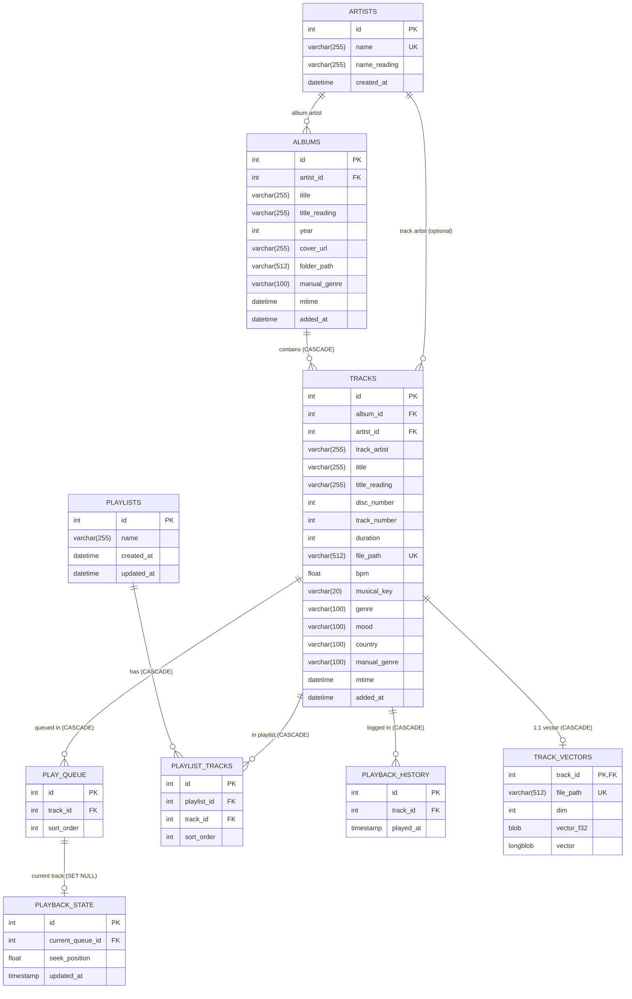

# FLAC Music Manager (Theatre of Eternal Music): 要件定義書 ＆ MySQLスキーマ改修設計書

これまで増築を重ねてきた現行システム（`flac-manager` / UI名: `Theatre of Eternal Music`）の**全機能要件・API仕様・UI/UX仕様**を網羅的に書き出し、本番データベース（`medialib_prod`: 32,489曲 / 3,286アルバム / 1,952アーティスト）の実データ分析に基づく**MySQLテーブル構造の課題と改善案**をまとめたドキュメントです。

---

## 第1部：現行システムの全機能要件定義

### 1. コア・バックエンド機能要件

#### 1.1 音楽ライブラリ・メタデータスキャン (`metadata_scanner.js`)
* **走査対象**: 環境変数 `MUSIC_DIR` 配下のディレクトリを再帰的に走査し、拡張子 `.flac`（大文字小文字不問）を対象とする。
* **除外ディレクトリ設定**:
  * 環境変数 `EXCLUDE_DIRS`（カンマ区切り）で指定されたパスに前方一致するディレクトリをスキップ。
  * システムディレクトリ `@eaDir`（Synology NAS等のサムネイル領域）および `flac-manager` 自身をハードコード除外。
* **差分スキャン (Delta Scan) とフルスキャン**:
  * デフォルト（引数なし）では起動時に `tracks` テーブルの `(file_path, mtime)` をメモリ上の `Map` にロード。
  * ファイルの `fs.statSync(filePath).mtime` とDB上の `mtime` を秒単位（`Math.floor(ms / 1000)`）で比較し、一致する場合はメタデータ解析をスキップ。
  * `--full` 引数指定時は全件を再解析・更新。
* **メタデータ抽出 (`music-metadata`)**:
  * `artist`: `common.artist`（未設定時は `'Unknown Artist'`）
  * `albumartist`: `common.albumartist`（未設定時は `artist` をフォールバック使用）
  * `album`: `common.album`（未設定時は `'Unknown Album'`）
  * `title`: `common.title`（未設定時は拡張子を除いたファイル名）
  * `track_number`: `common.track.no`（未設定時は `null`）
  * `year`: `common.year`（未設定時は `null`）
  * `duration`: `Math.round(format.duration || 0)`（秒単位の整数）
  * **コンピレーション正規化ルール**: `albumArtistName === 'autotune the world'` または `albumTitle.includes('Studio Simpa')` の場合、アルバムアーティストを `'Various Artists'` に自動統一。
* **日本語形態素解析による読み仮名自動付与 (`kuromoji`)**:
  * `node_modules/kuromoji/dict` 辞書を用いて、アルバムアーティスト名・アルバム名・トラック名をトークナイズし、カタカナ読み（`t.reading || t.surface_form`）を結合して生成。
  * それぞれ `artists.name_reading`, `albums.title_reading`, `tracks.title_reading` に保存。
* **カバーアート自動抽出 (`public/covers/`)**:
  * アルバム新規登録時、FLAC内の埋め込み画像（`common.picture[0]`）を最優先で取得。
  * 埋め込み画像がない場合、同フォルダ内の `cover.jpg`, `cover.png`, `folder.jpg`, `folder.png`, `front.jpg`, `front.png` を順に探索。
  * 抽出した画像を `public/covers/album_<album_id>.<ext>` として保存し、`albums.cover_url` に `/covers/album_<album_id>.<ext>` を記録。
* **運用・メンテナンススクリプト群**:
  * `dedupe_artists.js`: 重複登録された同名アーティストを最小IDへ統合し、`albums.artist_id` を付け替えた上で `UNIQUE KEY(name)` を再付与。
  * `cleanup_excluded.js`: `EXCLUDE_DIRS` 配下の `tracks`, `albums` および孤立した `artists` を物理削除。
  * `fix_collation.js` / `force_fix_collation.js`: DBおよびテーブルの文字コード・照合順序を `utf8mb4` / `utf8mb4_unicode_ci` に一括変換。

#### 1.2 楽曲ストリーミング配信 (`/api/stream/:id`)
* トラックIDから `tracks.file_path` を取得し、FLAC音声ストリーム（`Content-Type: audio/flac`）を返却。
* **HTTP Range リクエスト対応**:
  * `Range: bytes=start-end` ヘッダを解析し、`206 Partial Content`・`Accept-Ranges: bytes`・`Content-Range` を付与して `fs.createReadStream(filePath, { start, end })` でチャンク配信（ブラウザ上でのシーク操作に対応）。
  * `Range` ヘッダがない場合は `200 OK` でファイル全体をストリーム配信。

#### 1.3 再生キュー ＆ 再生状態のサーバー永続化 (`play_queue`, `playback_state`)
* **サーバーサイド永続化キュー (`/api/queue`)**:
  * 再生キューをブラウザメモリだけでなくMySQLの `play_queue` テーブルで永続管理。
  * 追加時は現在の `MAX(sort_order) + 1` から連番を振って複数トラックを一括 `INSERT`。
  * 個別削除 (`DELETE /api/queue/:id`)、全消去 (`POST /api/queue/clear`) に対応。
* **再生状態のリアルタイム同期・復元 (`/api/playback-state`)**:
  * シングルトン行（`playback_state.id = 1`）に `current_queue_id`（現在再生中のキュー要素ID）と `seek_position`（再生秒数）を保持。
  * フロントエンドから再生中5秒おき（`setInterval`）および曲切り替え・キュークリア時に自動保存。
  * ページリロード時や別デバイスからアクセスした際、前回の再生曲・シーク位置・キュー一覧をそのまま復元（自動再生はせず一時停止状態で待機）。

#### 1.4 プレイリスト管理 (`playlists`, `playlist_tracks`)
* プレイリストの作成 (`POST /api/playlists`)、一覧・収録曲数取得 (`GET /api/playlists`)、削除 (`DELETE /api/playlists/:id`)。
* プレイリストへのトラック一括追加 (`POST /api/playlists/:id/tracks`)：`MAX(sort_order) + 1` で末尾に順次追加。
* プレイリスト内の個別トラック削除 (`DELETE /api/playlists/:playlistId/tracks/:playlistTrackId`)。

#### 1.5 再生履歴の記録・閲覧 (`playback_history`)
* トラックが最後まで再生完了したタイミング（`audio.onended` イベント発火時）で `POST /api/history` を呼び出し、`playback_history` に記録。
* 直近N件（デフォルト50件、UIからは100件指定）の再生履歴を新しい順に取得 (`GET /api/history`)。

#### 1.6 FAISS ベクトル類似検索・Autoplay・Autogenプレイリスト (`track_vectors`)
* **インメモリ FAISS インデックス構築 (`initFaiss`)**:
  * サーバー起動時、`track_vectors` と `tracks` を `file_path` で結合して全ベクトル（Python `pickle` 形式の `LONGBLOB`、計32,489件）を読み込み。
  * 子プロセス `python3` にストリーム入力してデコードし、JSON配列として受け取った特徴量ベクトルを `faiss.IndexFlatL2`（L2距離インデックス）に登録。
* **類似曲レコメンド (`/api/recommendations/:trackId`)**:
  * 指定されたシード曲のベクトルを `faissIndex.search(vec, 100)` で検索。
  * **重複・履歴除外フィルタ**: 現在 `play_queue` に入っている曲、および `playback_history` の直近100曲を除外（候補が0件になる場合は履歴除外を緩和→さらに0件なら除外なしにフォールバック）。
  * **フォルダ分散ロジック**: 同じアルバム（同一 `folder_path`）の曲が連続して選ばれないよう、直前の曲と異なる `folder_path` を持つ最類似曲を優先選択。
  * **多段階フォールバック**: シード曲にベクトルが存在しない場合、同一トップレベルカテゴリ（`SUBSTRING_INDEX(folder_path, '/', 4)`）内のベクトル保有曲をランダムに1曲選んで代用 → それでも無ければ同カテゴリからランダム5曲 → ライブラリ全体からランダム5曲を返却。
* **Autoplay（自動連続再生）**:
  * クライアント側で Autoplay が `ON`（かつシャッフル `OFF`）のとき、キューの最後の曲の再生が終了した時点で `/api/recommendations/:trackId?limit=5` を呼び出し、類似曲5曲を自動でキュー末尾に追加して再生を継続。
* **Autogen プレイリスト生成 (`/api/autogen-playlist`)**:
  * ベクトル保有曲の中からランダムに1曲（シード曲）を選択し、FAISSで上位200件の類似曲を検索。
  * キュー内・直近100件の履歴除外および「連続する曲で同一フォルダを避ける」分散ルールを適用して20曲のリストを生成。

#### 1.7 検索・ソート・フォルダブラウズ仕様
* **ひらがな・カタカナ横断検索 (`wanakana`)**:
  * 検索クエリを `wanakana.toKatakana(search)` でカタカナに変換。
  * アルバム検索では `albums.title`, `artists.name`, `albums.folder_path`, `albums.title_reading`, `artists.name_reading` の5カラムに対して部分一致（`LIKE %...%`）検索を実行。
  * アーティスト検索では `artists.name`, `artists.name_reading`, および紐づく `albums.folder_path` を横断検索。
* **5種類のソート順**:
  * `alpha`: アーティスト名・アルバム名順（A-Z）
  * `newest`: ファイル更新日時（`mtime DESC`）順
  * `added`: DB登録日時（`added_at DESC`）順
  * `id_desc`: ID降順（Newest ID）
  * `id_asc`: ID昇順（Oldest ID）
* **仮想ディレクトリツリー走査 (`/api/folders/browse`)**:
  * ファイルシステムを直接叩くのではなく、`albums.folder_path` のプレフィックス文字列操作（`SUBSTRING_INDEX`）によって直下のサブフォルダ一覧と直下のアルバム一覧を高速抽出。
  * 指定フォルダ配下（サブフォルダ含む）の全トラック一括取得（`/api/folders/tracks`）に対応。

#### 1.8 外部可視化連携 (`create_grafana_views.js`)
* Grafana 等のBIツールから時系列・統計分析を行えるよう、以下の8つのSQL VIEWを提供:
  * `v_grafana_artists`, `v_grafana_albums`, `v_grafana_tracks`, `v_grafana_playback_history`, `v_grafana_playlists`, `v_grafana_playlist_tracks`, `v_grafana_play_queue`, `v_grafana_track_vectors`

---

### 2. フロントエンド・UI/UX機能要件 (`public/index.html`)

#### 2.1 ナビゲーション（8タブ構成）とドリルダウンビュー
1. **Albums タブ**: ページネーション（1ページ50件、上下ページャー）、検索、ソート対応のアルバムリスト（ID・通し番号・アーティスト名・アルバム名・カテゴリパス `[Genre]`・リリース年・更新日を表示）。クリックで収録曲一覧へ。
2. **Artists タブ**: ページネーション、検索、ソート対応のアーティストリスト。クリックでそのアーティストのアルバム一覧へドリルダウンし、さらにアルバムクリックで収録曲一覧へ。
3. **Folders タブ**: 現在のパス表示、`.. (Go Up)` による親フォルダ移動、サブフォルダ一覧（📁アイコン）、直下のアルバム一覧を表示。
4. **Playlists タブ**: `+ New Playlist` ボタン、プレイリスト一覧（収録曲数表示）。クリックでプレイリスト内のトラック一覧（`Play All`, `Add to Queue`, 個別削除 `×` ボタン）を表示。
5. **Random タブ**: ランダム抽出した20枚のアルバムを表示（`Refresh Random` ボタンで再抽選）。
6. **Autogen タブ**: FAISS類似度ベースの自動生成20曲リストを表示。`Play Now`（キューをクリアして即時再生）、`Refresh Autogen`（再生成）、`Add to Queue`（キュー末尾に追加）、`Save to Playlist`（名前を付けて新規プレイリスト保存）の4アクションを提供。
7. **History タブ**: 直近100件の再生完了履歴（順位、アーティスト名、曲名、`[アルバム名]`、再生完了日時）を表示。クリックで即時再生。
8. **Settings タブ**:
   * **Theme**: `Light`, `Dark`, `OLED`（完全黒背景 `#000000`）, `Sepia` の4テーマ切り替え（`localStorage` 保存、未設定時はOSの `prefers-color-scheme: dark` に追従）。
   * **Display Mode**: `Normal`（標準余白） / `Compact`（高密度リスト表示）の切り替え（`localStorage` 保存）。
   * **Autoplay (FAISS)**: `OFF` / `ON` の切り替え（`localStorage` 保存）。

#### 2.2 常駐プレイヤーバー ＆ スライド式プレイキュー・ドロワー
* **下部固定プレイヤーバー**:
  * 左エリア：現在再生中の曲名・アーティスト名。
  * 中央エリア：シャッフル（🔀）、前の曲（⏮：先頭に戻る or 前曲）、再生/一時停止（▶/⏸）、次の曲（⏭）、リピート（🔁：全曲リピート ON/OFF）、現在時刻 / 総時間、クリックシーク対応プログレスバー。
  * 右エリア：キュードロワー開閉ボタン（`≡`）、音量スライダー（`0.00`〜`1.00`、`localStorage` 保存）。
* **右スライド式 Play Queue ドロワー (`#queue-view`)**:
  * キュー内トラック一覧（`1/N` 番号、曲名、アーティスト名、個別削除 `×` ボタン）と `Clear Queue` ボタン。
  * 現在再生中のアイテムをハイライトし、`scrollIntoView({ behavior: 'smooth', block: 'nearest' })` で自動スクロール。

#### 2.3 右クリック・コンテキストメニュー (`#context-menu`)
各要素の右クリック時に画面端のはみ出し計算付きのカスタムメニューを表示：
* **Album 右クリック**: `Add Album to Queue`, `Play Album Now`, `Add to Playlist`（既存プレイリスト一覧 ＋ `+ New Playlist...`）
* **Folder 右クリック**: `Add All in Folder to Queue`, `Add to Playlist`（既存プレイリスト一覧 ＋ `+ New Playlist...`）
* **Artist 右クリック**: `Add All Artist Tracks to Queue`
* **Playlist 右クリック**: `Add Playlist to Queue`, `Delete Playlist`
* **Track 右クリック**: `Add to Queue`, `Play Now`, `Add to Playlist`（既存プレイリスト一覧 ＋ `+ New Playlist...`）

#### 2.4 キーボードショートカット（入力フォームフォーカス時は無効化）
* `Space`: 再生 / 一時停止
* `q`: プレイキュードロワーの開閉
* `k` / `j`: 音量 +5% / -5%
* `l` または `n`: 次の曲へ
* `h` または `p`: 前の曲へ

---

### 3. UI・コードベースにおける現状の課題（なぜリファクタリングが必要か）

1. **単一HTMLファイル（991行）への全機能密結合とUIの不統一**:
   * `public/index.html` 1ファイル内にCSS・HTML・状態管理・API通信・DOM文字列生成（`innerHTML`）がすべて詰め込まれている。
   * アルバム曲一覧、プレイリスト曲一覧、Autogen曲一覧、履歴一覧、キュー一覧がそれぞれ別々のテンプレート文字列で書かれており、行の高さ・余白・フォントサイズ・アーティスト名の表示位置・ホバー時のボタン挙動がバラバラになっている。
2. **画面遷移・状態管理の破綻**:
   * URLルーティングが存在せず、`#track-view` の `hidden` クラス付け替えと `onclick` ハンドラの動的書き換えで「戻る」ボタンを実装しているため、タブ切り替えや階層移動を繰り返すと「戻る」先が不整合を起こす。ブラウザの「戻る/進む」ボタンやリロードでも画面位置が失われる。
3. **カバーアート資産の未活用**:
   * スキャナーが `public/covers/` に493枚のアルバムカバー画像を抽出しDBにも `cover_url` を保存しているにもかかわらず、UI側で一切表示されていない（プレイヤーバーやアルバム詳細でも未表示）。
4. **ネイティブ `prompt()` / `alert()` / `confirm()` の多用**:
   * プレイリスト作成や削除確認がブラウザ標準の同期ダイアログに依存しており、テーマ（Dark/OLED/Sepia）から浮いてしまっている。

---

## 第2部：MySQLテーブル構造（`medialib_prod`）の現状課題と改善案

現在の本番DB（`medialib_prod`：9テーブル＋バックアップ3テーブル＋Grafana用8ビュー）の実データを調査した結果、以下の構造的課題が判明しました。

### 1. 現行スキーマの課題（実データに基づく診断）

#### 課題①：`albums` の `UNIQUE KEY (artist_id, title)` による「別フォルダ・複数ディスクの意図しない結合」
* **現象（実データで発生中）**:
  * **タグ未設定ファイルの衝突**: `Unknown Artist` × `Unknown Album` の曲が、全く無関係な7つのフォルダ（`/mnt/y/EasyListening/脳内革命/...` 等）から単一のアルバム（`id=684`）に統合されてしまっている。
  * **複数枚組（Multi-Disc）や別エディションの衝突**: 同一アーティスト・同一アルバムタイトルで `Disc1`, `Disc2`, `Disc3` とフォルダが分かれているアルバム（例：`id=15 Charles Curtis` 等）が1つのアルバムレコードに統合され、`albums.folder_path` には最初にスキャンされた `Disc1` のパスしか残らない。結果として **Folders ビューで `Disc2` フォルダを開いてもアルバムが1件も表示されない**バグを引き起こしている。
  * **トラック番号の重複**: `tracks` テーブルに `disc_number` カラムが存在しないため、2枚組以上のアルバム（実データで16アルバム）において `track_number = 1, 1, 2, 2...` と重複し、曲順が混ざって再生される。

#### 課題②：コンピレーションアルバム（`Various Artists`）におけるトラック別アーティスト情報の消失
* **現象（実データで269アルバムが該当）**:
  * `tracks` テーブルに `artist_id`（または `track_artist`）が存在せず、`albums.artist_id` しか保持していない。
  * `metadata_scanner.js` は `albumartist`（またはコンピレーション判定された `'Various Artists'`）を `artists` に登録して `albums.artist_id` に紐づけるため、**269枚の `Various Artists` アルバムに収録されている全トラックで「実際に歌っている/演奏しているトラックアーティスト名（`common.artist`）」がDBから完全に欠落**している。

#### 課題③：`track_vectors` が `track_id` ではなく `file_path` 文字列で結合されており、Python Pickle バイナリを都度デコードしている
* **現象（全32,489曲）**:
  * `track_vectors` テーブルは `tracks.id` への外部キーを持たず、`file_path VARCHAR(512)` で JOIN している。ファイル移動やパス変更時に孤立しやすい上、512文字の文字列JOINはインデックスサイズ・検索速度ともに非効率。
  * さらに、ベクトルデータが Python の `pickle` 形式（`LONGBLOB`）で格納されているため、Node.js サーバーは**起動時だけでなく `/api/recommendations/:trackId` や `/api/autogen-playlist` が呼ばれるたびに毎回 `child_process.spawn('python3')` を起動して `pickle.load` を実行**している。これはプロセス生成オーバーヘッドが大きく、セキュリティ面・ポータビリティ面でも負債となっている。

#### 課題④：インデックス不足によるクエリパフォーマンスの劣化
現行の本番テーブル（`SHOW CREATE TABLE` で確認）には、アプリケーションが頻繁に発行するクエリに対するインデックスが欠落しています。
* `albums`: `folder_path`, `mtime`, `added_at` にインデックスが無く、Folders ビューの `WHERE folder_path LIKE '...%'` やソート（`ORDER BY mtime DESC`, `ORDER BY added_at DESC`）で毎回全件走査（Full Table Scan: 3,286行）が発生。
* `tracks`: `(album_id, track_number)` の複合インデックスが無く、`album_id` 単一インデックスのみ。
* `play_queue`: `sort_order` にインデックスが無い。
* `playback_history`: `played_at` にインデックスが無く、`ORDER BY played_at DESC LIMIT 100` で毎回全件ソートが発生。
* `playlist_tracks`: `(playlist_id, sort_order)` の複合インデックスが無い。

#### 課題⑤：外部キー制約（`ON DELETE` 挙動）の不統一と孤立レコード
* `tracks.album_id` → `albums.id` および `albums.artist_id` → `artists.id` に `ON DELETE CASCADE` が設定されておらず（RESTRICT）、不要アルバム削除時に手動で子テーブルから順番に消す必要がある。
* 現在、どのアルバムからも参照されていない孤立アーティスト（Orphaned Artists）が4件残存している。
* また、過去のマイグレーション作業時に作られた `_backup_misc_migration_albums` (149件), `_backup_misc_migration_tracks` (990件), `_backup_misc_migration_vectors` (990件) が本番DB内に放置されている。

#### 課題⑥：拡張メタデータ（`bpm`, `musical_key`, `genre`, `mood`, `country`, `manual_genre`）の死蔵とスキャナー未連携
* **現象**:
  * 本番DBの `tracks` には `manual_genre`（全32,489件：トップレベルフォルダ名 `Rock_JP`, `Club`, `EasyListening` 等）、および `bpm`, `musical_key`, `genre`, `mood`（1,854件）、`country`（440件）が格納されており、`albums` にも `manual_genre`（全3,286件）が格納されている。
  * しかし `init_db.js` にはこれらのカラム定義すら無く、`metadata_scanner.js` もこれらを更新しないため、新規追加曲では `manual_genre` が `NULL` になる。
  * また、`server.js` やフロントエンドUIでも `manual_genre` や `bpm` 等を使った絞り込み・表示・レコメンド活用が一切行われておらず（代わりに `/mnt/y/` パス文字列のハードコード分割 `SUBSTRING_INDEX(..., '/', 4)` が使われている）、せっかくのデータ資産が死蔵している。

---

### 2. MySQLテーブル構造の改善案（リファクタリング方針）

既存の本番データ（32,489曲・再生履歴2,477件・プレイリスト・ベクトルデータ・拡張メタデータ）を**無損失でマイグレーション可能**な改善スキーマを提案します。

#### 改善①：アルバムの一意性定義の見直し＆マルチディスク完全対応
1. **`tracks` に `disc_number INT DEFAULT 1` と `track_artist VARCHAR(255)`（および必要に応じて `artist_id`）を追加**:
   * スキャナーで `common.disk.no` を取得して `disc_number` に保存。
   * アルバム内の曲順ソートを `ORDER BY disc_number ASC, track_number ASC, title ASC` に統一し、複数枚組アルバムの曲順混在を解消。
   * コンピレーションアルバム（`Various Artists`）でも各曲本来のアーティスト名を `tracks.track_artist`（および `tracks.artist_id`）に保持し、UIの曲一覧・プレイヤーバーで実際のアーティスト名を表示可能にする。
2. **アルバムの分割・フォルダ整合性**:
   * 同一アーティスト・同一タイトルであっても、別エディションや別フォルダの `Unknown Album` が誤って1つに統合されないよう、アルバムの識別キーを見直す（またはマルチディスクのサブフォルダ `CD1`/`CD2` を親フォルダ単位で正規化しつつ、`Unknown Album` は `folder_path` 単位で分離）。

#### 改善②：`track_vectors` の正規化とネイティブ Float32 バイナリ化（Python プロセス依存の廃止）
1. **`track_id INT PRIMARY KEY`（`FOREIGN KEY (track_id) REFERENCES tracks(id) ON DELETE CASCADE`）への移行**:
   * `file_path VARCHAR(512)` による文字列結合を廃止（または補助カラム化）し、`track_id` による1対1の主キー結合に変更。
2. **Python `pickle` から Raw Float32 バイナリ配列（または JSON / 事前構築インデックス）への変換**:
   * マイグレーション時に一度だけ既存の `pickle` バイナリを IEEE 754 `Float32Array` の生バイト列（`BLOB`）に変換して保存。
   * これにより Node.js 側で **`new Float32Array(buffer.buffer, buffer.byteOffset, buffer.byteLength / 4)` とするだけでゼロコピー・ミリ秒単位でベクトルを読み出し可能**になり、リクエストごとの `python3` プロセス起動が完全に不要になる。

#### 改善③：インデックスの最適化と外部キー制約の整理
* **複合インデックス・検索用インデックスの追加**:
  * `albums`: `INDEX idx_albums_folder (folder_path(255))`, `INDEX idx_albums_mtime (mtime DESC)`, `INDEX idx_albums_added (added_at DESC)`, `INDEX idx_albums_genre (manual_genre)`, `INDEX idx_albums_reading (title_reading)`
  * `tracks`: `INDEX idx_tracks_album_order (album_id, disc_number, track_number)`, `INDEX idx_tracks_reading (title_reading)`, `INDEX idx_tracks_genre_bpm (manual_genre, bpm)`
  * `play_queue`: `INDEX idx_queue_sort (sort_order)`
  * `playback_history`: `INDEX idx_history_played_at (played_at DESC)`
  * `playlist_tracks`: `INDEX idx_pt_playlist_sort (playlist_id, sort_order)`
* **外部キー `ON DELETE CASCADE` の統一**:
  * `tracks.album_id -> albums.id ON DELETE CASCADE`
  * これにより除外フォルダのクリーンアップやアルバム削除時に、関連トラック・キュー・履歴・ベクトルが自動的に整合性を保ってクリーンアップされる。

#### 改善④：カテゴリ（`manual_genre`）と音響特徴（`bpm`, `musical_key`, `genre`, `mood`）の正式サポート
* スキャナー実行時に `MUSIC_DIR` 直下の第1階層ディレクトリ名（例：`Rock_JP`, `Club`, `Jazz` 等）を自動的に `albums.manual_genre` / `tracks.manual_genre` に設定するよう標準化。
* これにより、`server.js` 内の `/mnt/y/` に依存した `SUBSTRING_INDEX(folder_path, '/', 4)` や `index.html` の `formatPath()` のハードコードを撤廃し、`manual_genre` カラムを用いたクリーンなカテゴリフィルタリング・フォールバック推薦を実現。
* バックアップ用の一時テーブル（`_backup_misc_migration_*`）はアーカイブ確認後に整理・削除。

---

### 3. 提案するターゲットER図（改修後スキーマ）

